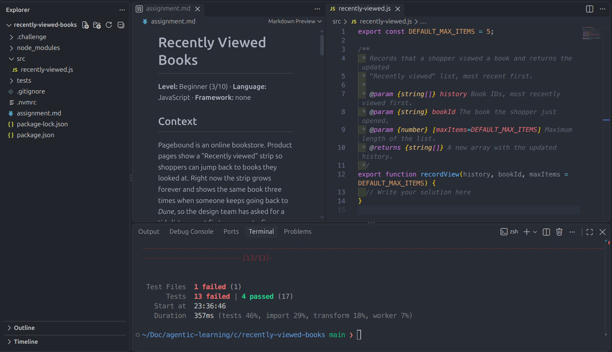
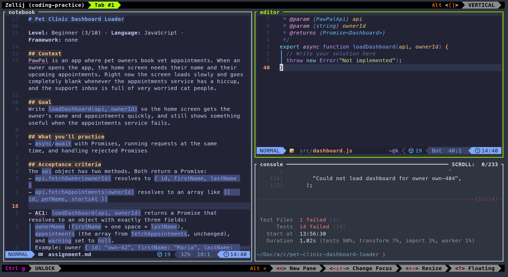

# Agentic Learning

Practice programming with realistic coding challenges, created and reviewed by an AI agent in [OpenCode](https://opencode.ai).

This repository ships two OpenCode skills:

| Skill | What it does |
|---|---|
| `create-coding-challenge` | Creates a practical challenge in the language, framework and difficulty (1–10) you choose: an assignment, starter code and runnable tests. It checks that the language toolchain is installed first and helps you install anything missing. |
| `review-coding-challenge` | Reviews your solution: runs the tests, adds extra edge-case tests from intermediate level up, and gives feedback on what you did well, which concepts to work on, and what to practice next. |

Challenges are based on real product problems (a checkout total, a log parser, a retry policy...), never abstract puzzles.

## Requirements

- [OpenCode](https://opencode.ai)
- [Git](https://git-scm.com)
- The toolchain for the language you want to practice (Node.js, Python, Go, Java, Rust...). You don't need to set it up in advance: the skill checks your machine and shows you how to install anything missing.

Built-in toolchain checks exist for JavaScript/TypeScript, Python, Java/Kotlin, Go, Rust, Ruby, C#/.NET and PHP. Other languages work too; the agent checks them manually.

## Quick start

```sh
git clone https://github.com/mandelbrojt/agentic-learning.git
cd agentic-learning/challenges
opencode
```

That's it. OpenCode finds the skills in `.opencode/skills/` automatically whenever you start it anywhere inside this repository.

This is how it looks when using Visual Studio Code as the IDE:


## Create your first challenge

In OpenCode, describe what you want to practice. For example:

```text
Create a coding challenge in Python about working with dates, difficulty 4
```

```text
Create a TypeScript challenge with React to practice forms, difficulty 6
```

```text
Create a Go coding challenge, surprise me with the topic, difficulty 8
```

You can also load the skill directly by typing `@create-coding-challenge` in your message.

What happens next:

1. **The agent asks for anything missing**: language, framework (or "none"), difficulty from 1 to 10, and topic. If you have no topic in mind, it suggests a few.
2. **It checks your toolchain.** If something is missing, it stops and shows you the install steps for your system. Commands that need `sudo` or edit your shell profile are always left to you.
3. **It creates a new folder** in the directory where you started OpenCode (here, `challenges/`), installs the project dependencies, and makes sure the tests run.

A challenge folder looks like this (a JavaScript example):

```text
challenges/pet-clinic-dashboard-loader/
├── assignment.md        ← start here: context, goal, acceptance criteria
├── src/dashboard.js     ← the code you write
├── tests/               ← the tests (read them, don't change them)
├── package.json         ← one setup command and one test command
└── .challenge/          ← metadata and rubric used by the reviewer
```

## Solve it

1. `cd` into the challenge folder and open `assignment.md`.
2. Read the acceptance criteria (`AC1`, `AC2`...). Every test name starts with the criterion it checks.
3. Write your code in the files listed under **Files** in the assignment.
4. Run the test command shown in the assignment (for example `npm test` or `.venv/bin/python -m pytest`) until everything passes.

Try to solve it yourself before asking the agent for help. The point is to learn by writing the code.

## Get a review

When the tests pass, ask OpenCode from inside the challenge folder (or mention the folder name):

```text
Review my solution
```

or load the skill directly with `@review-coding-challenge`.

The review runs the visible tests and, at intermediate and advanced levels, adds hidden edge-case tests generated on the spot. It then checks your code against the challenge rubric and gives feedback with your strengths, knowledge gaps, and next steps.

## Difficulty levels

| Difficulty | Level | What you get |
|---|---|---|
| 1–4 | Beginner | One concept, step-by-step instructions, hints and docs links, all tests visible |
| 5–7 | Intermediate | One or two concepts, a couple of short tips, extra edge-case tests at review time |
| 8–10 | Advanced | Several concepts plus design decisions, only constraints (no guidance), more hidden tests at review time |

Harder means less guidance, never less clarity: the acceptance criteria always say exactly what "done" means.

## Optional: a console-based setup

Any editor works for these challenges, including VS Code or another IDE. If you prefer to work entirely in the terminal, here is one setup that works well. It's only a suggestion: install the tools however you like and make the configuration your own.



- **notebook** (left): `assignment.md` open in Neovim, to keep the acceptance criteria in view
- **editor** (top right): the code you're writing
- **console** (bottom right): run the tests and other commands here

### Tools

- [Zellij](https://zellij.dev): a terminal workspace with panes, tabs, and sessions you can leave and come back to. See the [installation guide](https://zellij.dev/documentation/installation).
- [Neovim](https://neovim.io) with [LazyVim](https://www.lazyvim.org): a fast terminal editor with IDE features. LazyVim needs Neovim 0.11.2 or newer. Install it with the [LazyVim starter](https://www.lazyvim.org/installation) and customize it from there.

### Start the workspace

This repository includes a Zellij layout with the three panes above. From the repository root, run:

```sh
zellij --session coding-practice --new-session-with-layout extras/zellij/coding-practice.kdl
```

All panes open in `challenges/`. Then, for example:

- In **notebook**: `nvim <challenge>/assignment.md`
- In **editor**: `nvim <challenge>/src/...`
- In **console**: `cd <challenge>` and run the test command

### Leave and come back

Detach from the session to close the terminal without losing your work. With Zellij's default keys, press `Ctrl o` and then `d`. Your panes and open files keep running in the background. To come back:

```sh
zellij attach coding-practice
```

Use `zellij list-sessions` to see your sessions. The bar at the bottom of Zellij always shows the keys available in the current mode.

A few LazyVim keys to get started: `Space` shows the available commands, `Space e` opens the file explorer, `Space f f` finds a file, and `:w` saves.

## Use the skills in every project (global install)

The quick start only loads the skills inside this repository. To use them from any directory, clone the repository once and point OpenCode to its skills folder in your global config, `~/.config/opencode/opencode.json` (create the file if it doesn't exist):

```jsonc
{
  "$schema": "https://opencode.ai/config.json",
  "skills": ["~/path/to/agentic-learning/.opencode/skills"]
}
```

Replace `~/path/to/agentic-learning` with the folder where you cloned the repository. If the file already exists, add only the `skills` entry and keep your other settings.

Keep in mind:

- Challenges are created in the directory where you start OpenCode, so start it in a folder meant for your practice work.
- Keep both skill folders side by side: the review skill uses files from `create-coding-challenge`.
- See the [OpenCode skills documentation](https://opencode.ai/v2/docs/skills/) for other options.

## Update

```sh
git pull
```

Everything you create in `challenges/` is ignored by git, so updates never conflict with your own work.

## Troubleshooting

- **The agent doesn't know the skills.** Make sure you started OpenCode inside this repository (or set up the global install). Ask "which skills are available?" to check. The skill IDs are `create-coding-challenge` and `review-coding-challenge`.
- **The challenge wasn't created because a tool is missing.** This is expected: the skill never creates a challenge your machine can't run. Follow the install steps it shows, then ask again.
- **Global install doesn't work.** Check that the path in `skills` points to the `.opencode/skills` folder inside the cloned repository, then restart OpenCode.

## License

[MIT](LICENSE)
